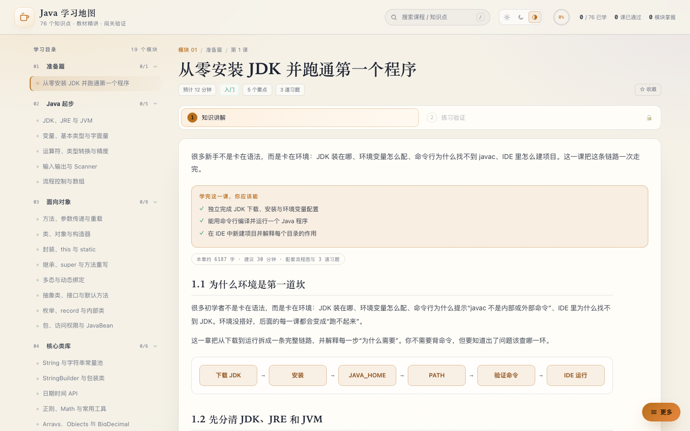
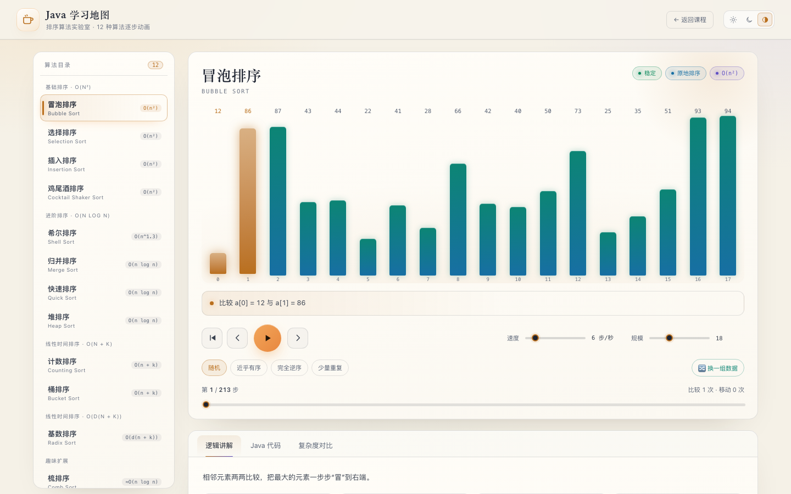

# Java 学习地图

一个**纯本地、零依赖**的 Java 全栈学习网站：20 个模块、84 个知识点、252 道习题。面向零基础，按「读教材 → 看流程图 → 勾选 → 做习题」的顺序一路学完。




## 怎么打开

直接**双击 `index.html`**（推荐 Chrome / Edge / Safari）。

不需要安装、不需要联网、不需要启动服务器。整个站点只有 HTML / CSS / JS 文件，没有任何 CDN 或外部字体。

## 三种主题

右上角可以在三种模式之间切换，选择会保存在本机：

- **☀ 日间**：暖白纸张底色，适合白天和明亮环境。
- **☾ 夜间**：深色底 + 低亮度代码画布，适合晚上长时间阅读。
- **◐ 跟随系统**：读取操作系统的 `prefers-color-scheme`，系统切换时页面同步变化。

## 导航与功能入口

顶栏只放两件事：**搜索**和**学习状态**。

- 左侧是站点标题；右侧依次是搜索框、主题切换、进度圆环（已学完 / 76）和小字统计（已学完、课已通过）。
- 搜索框可以点开，也可以直接按 `/` 聚焦：输入课程名、模块名、知识点或代码关键词，结果按相关度列出，摘要会定位到命中位置。`↑` `↓` 选择、`Enter` 直达对应课程、`Esc` 收起。
- 其余功能都收在右下角的「**☰ 更多**」悬浮菜单里，一屏之内看全，也不占正文空间。菜单按用途分三组，组内按常用程度排序：

| 分组 | 菜单项 | 作用 |
|---|---|---|
| 练习与测验 | 模块测验 | 按模块抽 15 题，20 分钟，答对 2/3（≥66%）通过 |
| | 结业考试 | 综合卷，交卷后给评分与逐题解析 |
| | 错题本 | 做错的题集中重做，附解析 |
| | 代码练习 | 输出预测 / 找错 / 填空，31 题 |
| 我的资料 | 书签 | 收藏的课程，一键跳回 |
| | 笔记 | 每课一条笔记，保存在本机 |
| | 进度数据 | 导出 / 导入 JSON，重置学习进度 |
| 拓展内容 | 排序算法实验室 | 跳到 `sorting.html`，12 种排序的逐步动画 |

原来那个把书签、笔记、数据包在一起的「学习工具」弹窗已经拆开了：三项各自是菜单里的一项，点开只显示这一项，不再需要先开弹窗再切标签。

**重置学习进度**在「进度数据」页底部：只清空勾选与考试成绩，书签、笔记和代码练习记录会保留，避免误删自己的笔记。

## 排序算法实验室（`sorting.html`）

课程里的排序算法只有静态流程图，所以单独做了一个可视化实验室：12 种排序的逐步动画、辅助数组展示、复杂度对比与 Java 实现，同样是本地文件，双击即可用。



- 侧栏切换 12 种算法：冒泡、选择、插入、鸡尾酒、希尔、归并、快速、堆、计数、桶、基数、梳排序。
- 播放 / 暂停、单步前进后退、拖动进度条回看，速度与数据规模可调，还有随机 / 近乎有序 / 完全逆序 / 少量重复四种预设。
- 每一步都告诉你「正在比较哪两个元素」，气泡图上的颜色对应已排序、基准、比较、交换四种状态。
- 与课程页共用同一套配色、圆角与三种主题；入口只有一个：首页右下角「☰ 更多」菜单里的「排序算法实验室」。它属于拓展内容，不占课程目录。

## 已移除交互动画

原来的「交互动画」标签页、步骤播放器、可点击图解、HashMap/Stream 小组件已**全部删除**，不再占用页面和注意力。只在讲流程的地方保留**静态流程图**，一眼看完，不需要操作。

当前共 81 张流程图，77 章有图；剩下 7 章（封装、抽象类与接口、枚举 record、包与 JavaBean、变量、运算符、SQL 基础）刻意不画，因为这几章讲的是概念与语法，画成流程图反而误导。例如：

1. 准备篇：下载 JDK → 安装 → 环境变量 → 验证 → IDE 运行
2. JDK 篇：源码 → 字节码 → 类加载 → 解释/JIT → 机器码
3. 方法：调用 → 压栈 → 执行 → 返回 → 回调用处
4. 类与对象：new → 堆分配 → 构造器 → 返回引用
5. 继承：子类构造 → super → 父类初始化 → 子类初始化
6. 多态：调用 → 实际类型 → 方法表 → 执行
7. Scanner：键盘 → 缓冲区 → 解析 → 变量
8. 循环：初始化 → 条件 → 循环体 → 更新 → 回到条件

## 教材式章节：84 章，纯汉字 ≥4500 的章节 83/84

20 个模块、84 章已全部教材化，纯汉字 ≥4500 的章节 83/84；内容从准备篇覆盖到 Spring 与项目实战，再到现代 Java 与 AI 工程。唯一例外是 `sql-jdbc`（3664 字）：它原本在模块 12 里重复讲 SQL，现已把 SQL 部分整体让给同模块的 `sql-basics`、只留 JDBC 本身，这是有意做的减法。

| 模块 | 章节 |
|---|---|
| 01 准备篇 | 从零安装 JDK 并跑通第一个程序 |
| 02 Java 起步 | JDK、JRE 与 JVM；变量、基本类型与字面量；运算符、类型转换与精度；输入输出与 Scanner；流程控制与数组 |
| 03 面向对象 | 方法、参数传递与重载；类、对象与构造器；封装、this 与 static；继承、super 与方法重写；多态与动态绑定；抽象类、接口与默认方法；枚举、record 与内部类；包、访问权限与 JavaBean |
| 04 核心类库 | String 与字符串常量池；StringBuilder 与包装类；日期时间 API；正则；Math 与常用工具；Arrays、Objects 与 BigDecimal；Java 8~25 新特性速览 |
| 05 集合框架 | 集合体系与 List；ArrayList 与 LinkedList；HashMap 的底层原理；Set、TreeSet 与比较器；迭代器、Queue 与 PriorityQueue；TreeMap、EnumMap 与 Properties |
| 06 异常与泛型 | 异常体系与 try-catch-finally；自定义异常与最佳实践；泛型类、方法与通配符；类型擦除与泛型限制 |
| 07 函数式编程 | Lambda 与函数式接口；Stream 流水线；Optional 与空值处理 |
| 08 IO 与 NIO | 字节流与字符流；缓冲流与 try-with-resources；文件与 NIO：Path / Files；序列化与 JSON；网络编程与 JSON |
| 09 并发编程 | 线程的创建与生命周期；synchronized、volatile 与原子性；线程池与 ExecutorService；并发集合与 CompletableFuture；死锁与 JMM 基础 |
| 10 JVM | 运行时内存区域；垃圾回收与常见收集器；类加载与双亲委派；字节码与性能调优入门 |
| 11 反射与设计模式 | 反射：在运行时操作类；注解与元注解；单例、工厂与建造者；策略、观察者与代理 |
| 12 数据库与 Web | SQL 基础：增删改查；JDBC：接口、五步与连接池；PreparedStatement 与事务；HTTP 与 Servlet 请求链路；Maven、Gradle 与单元测试 |
| 13 Spring 生态 | IoC 与依赖注入；Spring Boot 自动配置；Spring MVC 请求链路；MyBatis 与 JPA 数据访问；日志、打包与部署 |
| 14 现代 Java 与 AI 工程 | Java 21–25 语言演进与 LTS 迁移；虚拟线程落地与并发选型；Spring Boot 4 / Framework 7 迁移；Testcontainers 与数据库迁移脚本；Spring AI 接入 LLM；MCP 与工具编排；可观测性与原生化部署；AI 辅助开发与质量闸 |
| 15 项目实战 | 项目实战一：控制台图书管理系统；项目实战二：Spring Boot REST 接口 |
| 16 网络编程 | TCP/IP、Socket 与端口；HttpClient 与 HttpServer；NIO：Channel、Buffer 与 Selector |
| 17 安全与加密 | 编码、哈希与密码存储；对称加密、非对称加密与签名；HTTPS 与常见 Web 漏洞 |
| 18 Spring AOP 与 Security | Spring AOP 与动态代理；Spring Security 认证与授权 |
| 19 数据库进阶 | 索引、B+ 树与执行计划；事务隔离、MVCC 与锁；慢查询、分页与数据库优化 |
| 20 Redis 与消息队列（选修） | Redis 缓存与分布式锁；消息队列：解耦、削峰与幂等 |

每章包含：

- 12~34 个小节，从“为什么”讲到语法、边界和设计取舍
- 4~10 段可运行代码、运行结果
- 类型范围表、访问权限表、重载规则表、继承对比表等
- 一个综合案例（如员工薪资体系、购物车、命令行计算器、图书管理）
- 常见追问与自测练习
- 静态流程图（按需）
- 章末小结

学习页只有两个标签：**知识讲解** 和 **练习验证**。练习仍然需要先勾选「我已学完」才能解锁。

## 学习流程

1. **读教材**：目标、路线、分段正文、代码、流程图。
2. **勾选完成**：点「勾选：我已学完本知识点」。
3. **做习题**：3 道题，逐题判分、附解析；答对 2 题（≥2/3）标记为「已掌握」。
4. **进度保存**：勾选、分数、上次学到哪一课都存进 localStorage。

## 覆盖范围

| 模块 | 内容 |
|---|---|
| 01 准备篇 | 安装 JDK、环境变量、IDE、第一个程序（教材） |
| 02 Java 起步 | JDK/JRE/JVM、变量与类型、运算符、Scanner、流程控制与数组（教材） |
| 03 面向对象 | 方法与重载、类与对象、封装、继承、多态、抽象类/接口、枚举/record、包与 JavaBean（教材） |
| 04 核心类库 | String、StringBuilder/包装类、日期时间、正则、Arrays/BigDecimal、现代 Java |
| 05 集合框架 | List、ArrayList vs LinkedList、HashMap、Set/比较器、迭代器/队列、TreeMap/EnumMap |
| 06 异常与泛型 | 异常体系、自定义异常、泛型与通配符、类型擦除 |
| 07 函数式编程 | Lambda、Stream、Optional |
| 08 IO 与 NIO | 字节流/字符流、缓冲流、Path/Files、序列化、网络与 JSON |
| 09 并发编程 | 线程生命周期、synchronized/volatile、线程池、并发容器、死锁与 JMM |
| 10 JVM | 内存区域、垃圾回收、类加载、字节码与调优 |
| 11 反射与设计模式 | 反射、注解、单例/工厂/建造者、策略/观察者/代理 |
| 12 数据库与 Web | SQL、JDBC、PreparedStatement 与事务、HTTP/Servlet、Maven/JUnit |
| 13 Spring 生态 | IoC/DI、Boot 自动配置、Spring MVC、MyBatis/JPA、日志与部署 |
| 14 现代 Java 与 AI 工程 | LTS 与语言演进、虚拟线程、Boot 4 迁移、Testcontainers、Spring AI、MCP、可观测性与原生化、AI 质量闸（教材） |
| 15 项目实战 | 控制台图书管理系统、Spring Boot REST 接口 |
| 16 网络编程 | TCP/Socket、HttpClient/HttpServer、NIO Selector |
| 17 安全与加密 | 编码/哈希、AES/RSA/签名、HTTPS 与 Web 漏洞 |
| 18 Spring AOP 与 Security | 切面与代理、过滤器链、认证授权、JWT、BCrypt |
| 19 数据库进阶 | B+ 树索引、EXPLAIN、MVCC/锁、慢查询与分库分表 |
| 20 Redis 与消息队列（选修） | 缓存三坑、分布式锁、Kafka/RabbitMQ、幂等与积压 |

## 内容统计

- **20** 个模块
- **84** 个知识点
- **84** 章教材正文（纯汉字 3664~6668，83 章 ≥4500）
- **252** 道单选题（每题都有解析）
- **31** 道代码练习（输出预测 / 找错 / 填空）
- **81** 张静态流程图（77 章有图）
- **12** 种排序算法的可视化实验室（独立页面 `sorting.html`）

## 文件结构

```text
java-learning-lab/
├── index.html                    页面骨架（双击打开）
├── sorting.html                  排序算法实验室（12 种排序的逐步动画）
├── README.md
├── preview.png                   夜间模式首页
├── preview-light.png             日间模式准备篇
├── preview-sorting.png           排序算法实验室
├── css/
│   ├── style.css                 样式、日夜主题、教材与流程图排版
│   └── sorting.css               实验室样式（复用同一套设计令牌与主题）
├── js/
    ├── engine.js                 路由、主题、进度、教材渲染、练习引擎
    ├── search.js                 顶栏搜索：索引、命中摘要、键盘选择
    ├── menu.js                   右下角「更多」菜单（收集各模块注册的入口）
    ├── tools.js                  书签 / 笔记 / 进度数据三个弹窗
    ├── code-lab.js               代码练习弹窗：作答、判分、记录
    ├── code-exercises.js         代码练习题库 31 题（输出预测 / 找错 / 填空）
    ├── exams.js                  模块测验、结业考试、错题本
    ├── exam-extra-1.js           模块 01–05 的补充考题
    ├── exam-extra-2.js           模块 06–10 的补充考题
    ├── exam-extra-3.js           模块 11–16 的补充考题
    ├── exam-extra-4.js           模块 16–20 的补充考题
    ├── sorting-algorithms.js     12 种排序的动画步骤生成器
    ├── sorting-lab.js            实验室交互：播放、单步、对比、代码高亮
    ├── curriculum-1.js           课程数据：Java 起步 / 面向对象 / 核心类库
    ├── curriculum-2.js           课程数据：集合框架 / 异常与泛型 / 函数式编程
    ├── curriculum-3.js           课程数据：IO 与 NIO / 并发编程 / JVM
    ├── curriculum-4.js           课程数据：反射与设计模式 / 数据库与 Web / Spring 生态
    ├── curriculum-5.js           课程数据：准备篇、项目实战，并给已有模块补课
    ├── curriculum-6.js           课程数据：现代 Java、进阶集合、网络与 JSON 补课
    ├── curriculum-7.js           课程数据：网络编程 / 安全与加密 / Spring AOP 与 Security / 数据库进阶 / Redis 与消息队列
    ├── curriculum-14-modern.js    课程数据：现代 Java 与 AI 工程（8 课，插在 Spring 与项目实战之间）
    ├── guides-1.js               非教材章节的精讲与作业
    ├── guides-2.js               非教材章节的精讲与作业
    ├── guides-3.js               非教材章节的精讲与作业
    ├── guides-4.js               非教材章节的精讲与作业
    ├── guides-5.js               非教材章节的精讲与作业
    ├── deep-1.js                 非教材章节的逐步拆解与小结
    ├── deep-2.js                 非教材章节的逐步拆解与小结
    ├── deep-3.js                 非教材章节的逐步拆解与小结
    ├── deep-4.js                 非教材章节的逐步拆解与小结
    ├── textbook-basics-1.js      教材：准备篇、JDK 篇
    ├── textbook-basics-2.js      教材：变量与运算符
    ├── textbook-basics-3.js      教材：Scanner、流程控制
    ├── textbook-basics-extra.js  基础篇补充（目录、字节码、进制、位运算等）
    ├── textbook-oop-1.js         教材：方法与类对象
    ├── textbook-oop-2.js         教材：封装与继承
    ├── textbook-oop-3.js         教材：多态、抽象类与接口
    ├── textbook-oop-4.js         教材：枚举 record、包与 JavaBean
    ├── textbook-oop-extra.js     面向对象的案例、追问与自测
    ├── textbook-flows.js         面向对象的流程图
    ├── textbook-topup.js         早期补写的教材小节
    ├── textbook-topup-2.js       补写批次二（新增知识点）
    ├── textbook-topup-3.js       补写批次三（新增知识点）
    ├── textbook-projects-1.js    教材：控制台项目、Spring Boot 项目、SQL 基础
    ├── textbook-core-1.js        教材：String 到现代 Java
    ├── textbook-collections-1.js 教材：集合框架 6 章
    ├── textbook-exceptions-1.js  教材：异常、泛型、类型擦除、Lambda
    ├── textbook-fp-io-1.js       教材：Stream 到序列化
    ├── textbook-concurrency-1.js 教材：网络与 JSON、线程、并发容器、死锁与 JMM
    ├── textbook-jvm-1.js         教材：JVM 内存到注解
    ├── textbook-db-1.js          教材：设计模式到 JDBC、事务、构建与测试
    ├── textbook-db-adv-1.js      教材：索引与锁
    ├── textbook-db-adv-2.js      教材：数据库优化与 Redis
    ├── textbook-spring-1.js      教材：IoC 到部署
    ├── textbook-modern-1.js      教材：现代 Java 第 1–4 章（LTS 迁移、虚拟线程、Boot 4、Testcontainers）
    ├── textbook-modern-2.js      教材：现代 Java 第 5–8 章（Spring AI、MCP、可观测性、AI 质量闸）
    ├── textbook-net-1.js         教材：TCP/Socket、HttpClient/HttpServer
    ├── textbook-net-2.js         教材：NIO Selector、安全基础
    ├── textbook-sec.js           教材：加密与 Web 安全
    ├── textbook-springsec.js     教材：Spring AOP 与 Security
    └── textbook-mq.js            教材：消息队列
└── tools/
    └── verify.js                 一致性校验器：node tools/verify.js .（零依赖，退出码 0/1）
```

## 关于内容与版权

课程的知识点顺序参考了廖雪峰 Java 教程、菜鸟教程 Java 和 Java 学习笔记的公开目录，正文为原创重写，没有整段复制；那三家站点的正文受版权保护，不能直接搬运。

## 想自己加知识点？

在任意 `curriculum-*.js` 里向对应模块的 `lessons` 数组添加对象；精讲写在 `guides-*.js` 与 `deep-*.js`，教材正文写在 `textbook-*.js`，流程图用 <code>{ flow: ['步骤1', '步骤2'] }</code> 块。侧边栏、首页统计、模块进度会自动更新。

## 已验证

- 20 个模块、84 个知识点、252 道题、84 章教材与 81 张流程图全部通过脚本校验：`node tools/verify.js .` 10 条规则全 PASS、退出码 0。
- 无头 Chrome 逐页遍历了当时已有的 76 课（本轮新增的 8 章尚未做浏览器回归）：每页只有「知识讲解 / 练习验证」两个标签，练习锁定状态正常，0 个 JS 报错。
- 84 章教材正文纯汉字 3664~6668（只统计正文段落，不含代码块与运行结果；最低 `sql-jdbc`、最高 `hashmap`）。
- 完整走通「勾选 → 答题 → 100 分 → 写入 localStorage → 刷新恢复」。
- 日间/夜间/跟随系统三种主题均实测，系统深浅色切换与刷新记忆正常。
- 桌面（1440 宽）与手机（430 宽）布局均已截图检查。
- 新版导航：顶栏搜索（含 `/` 聚焦、↑↓ 选择）、悬浮「更多」菜单三组 8 项、书签 / 笔记 / 进度数据三个独立弹窗与重置卡均已无头截图核对；桌面 1440 与手机 500 宽布局正常。
- 排序算法实验室：无头 Chrome 实测 12 种算法全部加载、播放/单步/进度条正常、代码高亮与对比表可切换；日间与夜间（1440 宽）、窄屏（500 宽）均已截图检查；顶栏单一入口在桌面与窄屏都不折行。
